# CDP greenfield setup — `jgarv-cdp-env` (us-east-2)

Greenfield **Cloudera Public Cloud** environment for the fraud context layer. No dependency on the Model Governance demo app.

## Parameters

| Parameter | Value |
|-----------|--------|
| CDP environment name | `jgarv-cdp-env` |
| AWS region | `us-east-2` |
| Trino catalog / schema | `demobank` / `fraud` |
| Iceberg table pattern | `demobank.fraud.silver_*`, `gold_*`, `bronze_*`, `context_*` |
| Stream job cadence | 5 minutes (CDE schedule) |

## Prerequisites

- AWS account with EC2, S3, IAM, KMS quotas for a minimal Data Lake + services
- Cloudera account with CDP Public Cloud entitlement
- AWS CLI v2, Terraform optional (S3 landing bucket can be created in-console)
- Synthetic data uploaded to S3 (see README `make generate`)

## Recommended order

```mermaid
flowchart LR
  A[AWS account prep us-east-2] --> B[Register CDP with AWS]
  B --> C[Create environment jgarv-cdp-env]
  C --> D[Data Lake + SDX on S3]
  D --> E[Enable Cloudera AI]
  E --> F[Enable CDE]
  F --> G[Enable Trino]
  G --> H[Upload synthetic to S3]
  H --> I[CDE load_historic]
  I --> J[CDE microbatch + merge schedule]
  J --> K[Trino smoke queries]
  K --> L[Deploy Context Service on CAI]
```



### 1. AWS account prep

- Choose a VPC CIDR that does not overlap other projects (document your CIDR in internal notes).
- Ensure service quotas for instances used by CDP data services in **us-east-2**.

### 2. Register CDP with AWS

Follow [CDP on AWS reference architecture](https://docs.cloudera.com/cdp-public-cloud/cloud/aws-refarch/topics/cdp-pc-aws-refarch-overview.html): cross-account IAM role from Cloudera console.

### 3. Create environment

- Name: **`jgarv-cdp-env`**
- Region: **us-east-2**

### 4. Data Lake + SDX

- S3-backed Data Lake with **Ranger**, **Atlas**, Knox enabled.
- Create external location / storage resource for synthetic prefix, e.g. `s3://<bucket>/synthetic/`.

### 5. Enable Cloudera AI

- Create workspace for fraud context demo.
- Note workspace URL and credentials for Workbench apps.

### 6. Enable Cloudera Data Engineering (CDE)

- Spark 3.x runtime compatible with Iceberg libraries shipped for your CDP version.
- Create resource pool for `load_historic`, `microbatch_stream`, `silver_merge`.

### 7. Enable Trino

Steps vary slightly by CDP version; general pattern:

1. In Cloudera Management Console, enable **Trino** (or Trino-capable **Data Warehouse** service — use the Trino endpoint documented for your release).
2. Attach Trino to the **same** environment `jgarv-cdp-env` and Data Lake metastore.
3. Create catalog **`demobank`** (or map default catalog to Iceberg warehouse) and schema **`fraud`**.
4. Smoke test from console or CLI:

```sql
SELECT 1 AS ok;
-- after load_historic:
SELECT COUNT(*) FROM demobank.fraud.silver_customers;
```

Record JDBC/HTTPS Trino coordinator URL, user, and password in CAI workspace secrets for Context Service.

### 8. Upload synthetic data

From your laptop after `make generate SCALE=medium`:

```bash
aws s3 sync synthetic/out/full/ s3://YOUR_BUCKET/synthetic/fraud/ --region us-east-2
```

### 9. CDE jobs

| Job | Purpose | Schedule |
|-----|---------|----------|
| `load_historic` | Initial Iceberg population | On demand |
| `microbatch_stream` | Append replay window to bronze | Every **5** minutes |
| `silver_merge` | Promote bronze → silver | After micro-batch (chained or same workflow) |

Job entrypoints: `cde/jobs/*.py` (package and submit per CDE project docs).

### 10. Context Service on Cloudera AI

- Deploy `context-service` as a **Workbench** long-running app (see `agent/README-cai-deploy.md`).
- Set env: `TRINO_*`, `CDP_REPLAY_FIXTURES_DIR`, `STREAM_INJECTION_DEFAULT=false`.
- Deploy `demo-ui` Streamlit app pointing at Context Service URL.

### 11. Credentials (public API)

Generate CDP **access key** in console for optional Atlas/control-plane calls. Store in workspace secrets. **No VPC peering** required for MVP; data access is Trino from within CAI/CDE.

## Smoke test checklist

- [ ] Trino queries `demobank.fraud.gold_cases` for `CASE-001`..`003`
- [ ] After 2 micro-batch cycles, `silver_stream_events` row count increases
- [ ] Context Service `/v1/stream/recent` returns new events
- [ ] Ranger mask hides configured sensitive column in Trino
- [ ] Streamlit toggle changes injection; follow-up alert appears for `CASE-002` when scripted window applied

## Cost control

Stop or suspend data services when idle. Tear down `jgarv-cdp-env` when not demoing.
