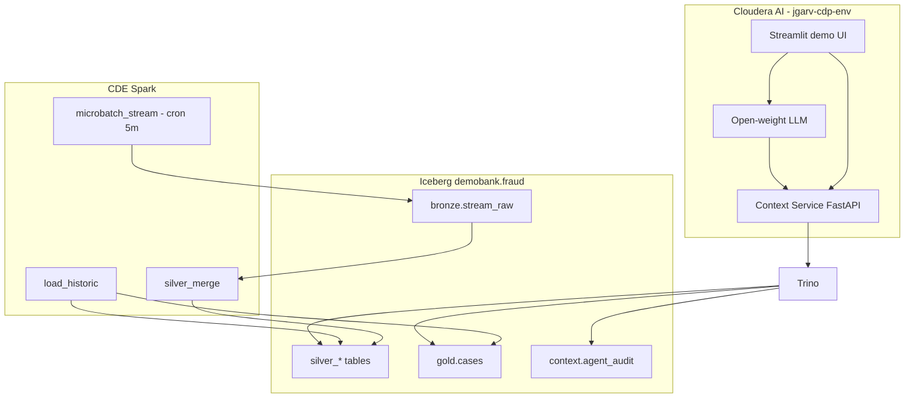

# FSI Fraud Context Layer — Design Spec

**Status:** Approved for implementation  
**Audience:** Financial crime analytics, platform engineering, Cloudera practitioners  
**Hero use case:** AML / fraud investigation agent with governed lakehouse context  
**Deployment:** Greenfield CDP Public Cloud on AWS (`jgarv-cdp-env`, `us-east-2`)  
**Data:** Synthetic only (cases, customers, transactions, stream replay)

---

## 1. Problem statement

Investigation agents need a **single, policy-aware context surface** that blends **90-day customer history** with **recent “streaming” activity**, without giving models direct lake credentials. The platform must showcase **Iceberg**, **Trino**, **CDE**, **Atlas/Ranger (SDX)**, and **Cloudera AI** for US FSI audiences.

---

## 2. Scope

| In scope | Out of scope |
|----------|----------------|
| Synthetic historic load (medium: ~5k customers, ~1M txns / 90d) | Real case systems (Actimize, etc.) |
| Simulated stream via **CDE micro-batch every 5 min** | Live Kafka/NiFi MVP |
| Context Service on **Cloudera AI** | Model Governance ECS app |
| Single open-weight agent + optional Streamlit UI | Multi-agent orchestration v1 |
| Public CDP APIs + fixture replay for lineage | VPC peering to data plane |

---

## 3. Architecture

### Tiers

| Tier | Components |
|------|------------|
| Synthetic source | Python generator → S3 landing |
| Ingest (batch) | CDE `load_historic`, `microbatch_stream`, `silver_merge` |
| Lakehouse | S3 + Iceberg, schema `fraud`, tables `silver_*`, `gold_*`, `bronze_*`, `context_*` |
| SQL | Trino (`demobank` catalog) |
| Governance | Ranger masks, Atlas entities (public API + replay fixtures) |
| Context API | FastAPI tools, governed SQL templates, stream injection toggle |
| Agent | CAI project, tool calling to Context Service |
| Demo UI | Streamlit: chat + sources + injection toggle |

---

## 4. Data model (Trino: `demobank.fraud.*`)

| Table | Layer | Description |
|-------|-------|-------------|
| `silver_customers` | silver | party_id, segment (retail/smb), risk_tier, synthetic name |
| `silver_accounts` | silver | account_id, party_id, product (card, ach, wire) |
| `silver_transactions` | silver | txn_id, account_id, amount, channel, event_time |
| `silver_entities` | silver | entity_id, typology hints for graph demo |
| `silver_entity_links` | silver | entity_id, party_id, link_type |
| `silver_fraud_alerts` | silver | alert_id, case_id?, score, typology, event_time |
| `silver_stream_events` | silver | event_id, stream_type, payload_json, event_time, ingest_batch_id |
| `gold_cases` | gold | case_id, status, primary_party_id, opened_at |
| `gold_case_timeline` | gold | case_id, event_type, detail, event_time |
| `bronze_stream_raw` | bronze | raw replay lines before merge |
| `bronze_ingest_checkpoint` | bronze | micro-batch cursor |
| `context_agent_audit` | context | session_id, turn, tool, hash, event_time |

**Demo cases:** `CASE-001` (retail CNP), `CASE-002` (ATO + wire, scripted follow-up), `CASE-003` (SMB mule graph).

**PII:** Synthetic only; columns `pan_last4`, `tax_id_token` always masked at read time via Ranger + Context Service redaction.

---

## 5. Stream simulation

1. **Replay ledger** (JSONL windows on S3) produced by `fraud_synthetic generate`.
2. **CDE job `microbatch_stream`** (schedule: **5 minutes**) reads next window, appends to `bronze_stream_raw`, updates checkpoint.
3. **`silver_merge`** promotes to `silver_stream_events` and optional new rows in `silver_fraud_alerts`.
4. **Scripted injection** (`synthetic/scripted_alerts.yaml`): when Context Service `stream_injection_enabled=true`, micro-batch prioritizes manifest windows (e.g. `CASE-002` follow-up alert).

---

## 6. Context Service API (summary)

| Method | Path | Purpose |
|--------|------|---------|
| GET | `/health` | Liveness |
| GET | `/v1/cases/{case_id}` | Case dossier + timeline |
| GET | `/v1/customers/{party_id}/history` | 90d summary |
| GET | `/v1/stream/recent` | Recent stream events (Trino) |
| POST | `/v1/sql/governed` | Template-only SQL |
| GET | `/v1/lineage/{qualified_name}` | Atlas or replay fixture |
| POST | `/v1/admin/stream/injection` | Enable/disable scripted alerts |
| POST | `/v1/audit/turn` | Append agent audit row |

OpenAPI: `context-service/openapi.yaml`.

---

## 7. Agent (Cloudera AI)

- **One** tool-calling loop; tools map to Context Service REST endpoints.
- **Open weights only** (e.g. Llama 3.2 3B / Phi-3-mini) on CPU or small GPU.
- No external LLM APIs.

---

## 8. CDP environment

| Setting | Value |
|---------|--------|
| Environment name | `jgarv-cdp-env` |
| AWS region | `us-east-2` |
| Services | Data Lake + SDX, Cloudera AI, CDE, Trino |
| Connectivity | Public CDP APIs; Trino from CAI workspace network |

See [cdp-greenfield-setup.md](../../cdp-greenfield-setup.md).

---

## 9. Global constraints

- Synthetic data only; no production feeds.
- Batch-first agent demo; stream is simulated micro-batch.
- Catalog/schema: `demobank.fraud`, tables `silver_*`, `gold_*`, `bronze_*`, `context_*`.
- Stream cadence: **5 minutes**.
- Stream injection toggle: **Context Service admin API + Streamlit UI**.
